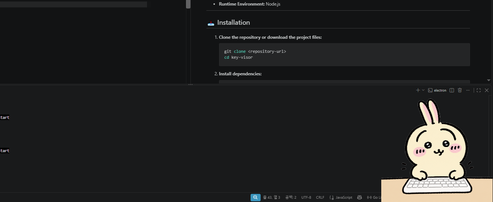

<div align="right">
  <a href="README.md"></a>
  <a href="README.ko.md"></a>
</div>

# Chiikawa Usagi Key Visor

A desktop overlay application that stays always on top, runs transparently without a title bar or borders, and dynamically changes character images based on your global keyboard input.



## ✨ Features

- **Always on Top:** Floats above any active program or game.
- **Transparent Overlay:** Borderless and transparent background.
- **Dynamic Character Animation:**
  - Switches between `left.png` and `right.png` on key presses.
  - Returns to `idle.png` after 0.5 seconds of inactivity.
  - Transforms to `fire.png` after 3 seconds of continuous inactivity.
- **System Tray Integration:** Runs quietly in the system tray with background persistence.

---

## 🛠️ Tech Stack & Libraries

- **Framework:** [Electron](https://www.electronjs.org/) (v28+)
- **Global Key Listener:** [uiohook-napi](https://www.npmjs.com/package/uiohook-napi) (System-wide `keydown` detection)
- **Runtime Environment:** Node.js

---

## 📥 Installation

1. **Clone the repository or download the project files:**

   ```bash
   git clone <repository-url>
   cd key-visor
   ```

2. **Install dependencies:**

   ```bash
   npm install
   ```

3. **Rebuild native modules (Required for `uiohook-napi`):**
   ```bash
   npx electron-rebuild -f -w uiohook-napi
   ```

---

## 🚀 How to Run

1. Start the application in development mode:
   ```bash
   npm start
   ```

---

## ❌ How to Quit

- Since the app hides from the Windows taskbar (`skipTaskbar: true`) and floats as a transparent overlay, you can quit it safely via the **System Tray**:
  1. Look at the bottom-right corner of your screen (system tray / notification area near the clock).
  2. Right-click the **Key Visor** tray icon (`icon.png`).
  3. Click **Quit** to completely shut down the application.
